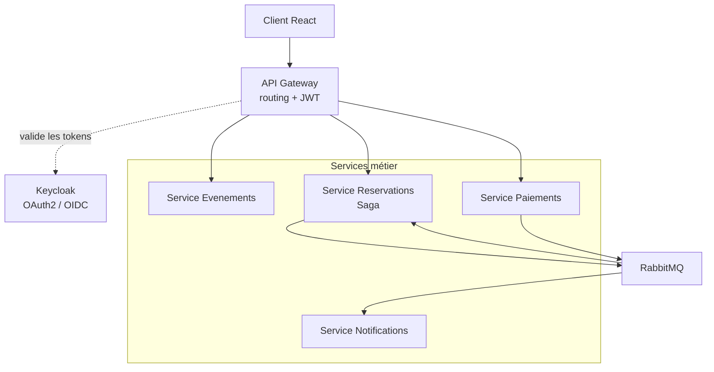
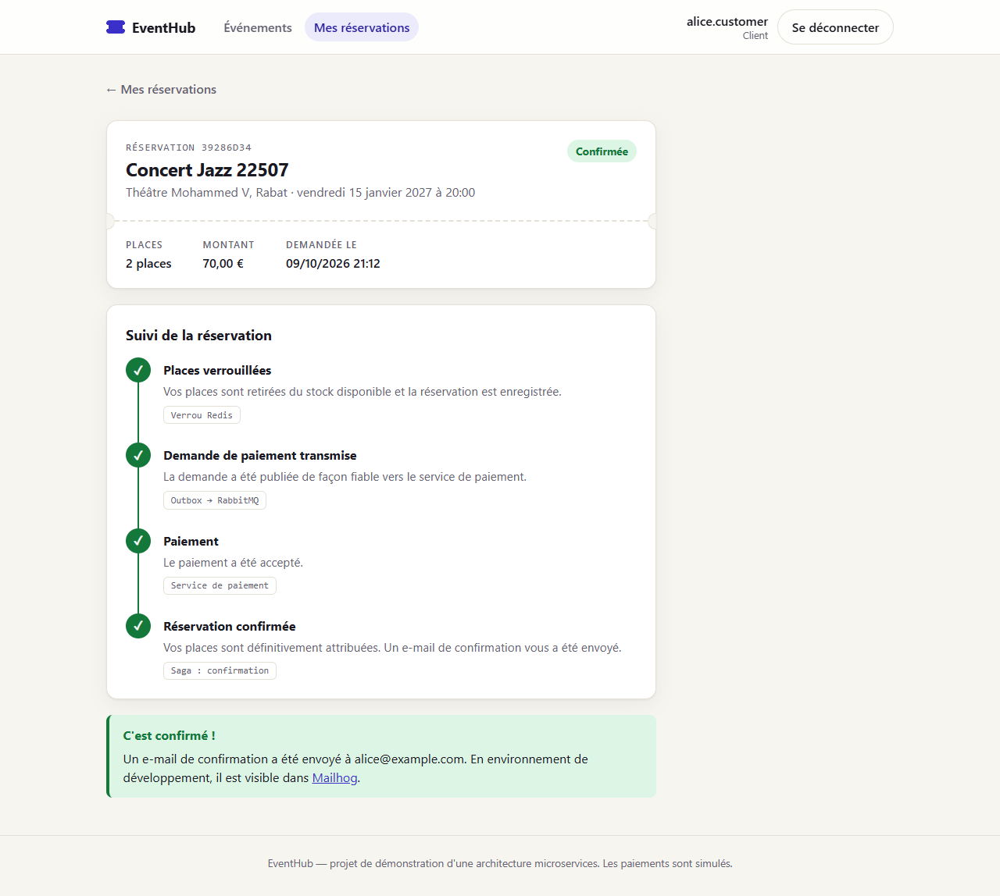

# EventHub

[](https://github.com/BOUSSOUF-Hajar/EventHub/actions/workflows/ci.yml)

Plateforme de reservation de billets pour evenements (concerts, conferences, sport), construite comme un ensemble de microservices Spring Boot avec un frontend React.

Projet pense pour mettre en pratique — et pouvoir argumenter en entretien — une architecture microservices realiste : authentification centralisee (Keycloak), communication asynchrone (RabbitMQ), Saga avec compensation, et un pipeline CI/CD complet.

> Le detail des exigences fonctionnelles et techniques est dans [`CAHIER_DES_CHARGES.md`](./CAHIER_DES_CHARGES.md).

## Sommaire

- [Architecture](#architecture)
- [Stack technique](#stack-technique)
- [Demarrage rapide](#demarrage-rapide)
- [Structure du projet](#structure-du-projet)
- [Roadmap](#roadmap)
- [Patterns mis en oeuvre](#patterns-mis-en-oeuvre)
- [Tests](#tests)
- [Intégration continue](#intégration-continue)
- [Licence](#licence)

## Architecture



Chaque service métier possède sa **propre base de données** (pattern *database per service*) et ne communique avec les autres que via des **événements RabbitMQ** ou via le Gateway pour les appels synchrones depuis le frontend.

## Stack technique

| Couche | Choix |
|---|---|
| Backend | Java 17, Spring Boot 3, Spring Cloud Gateway |
| Sécurité | Keycloak (OAuth2 / OIDC), Spring Security Resource Server |
| Messaging | RabbitMQ |
| Données | PostgreSQL (une instance par service), Redis (verrou de places) |
| Frontend | React 18, TypeScript, Vite, React Query, react-oidc-context |
| Tests | JUnit 5, Mockito, Testcontainers, Vitest |
| CI/CD | GitHub Actions, Docker |

## Demarrage rapide

### Tout dans Docker

**Prérequis** : Docker & Docker Compose, rien d'autre.

```bash
docker compose up -d --build
```

Cette commande construit les images des cinq services et du frontend, puis démarre l'ensemble avec l'infrastructure (Postgres x3, RabbitMQ, Keycloak, Redis, Mailhog). Le premier build télécharge les images de base et les dépendances Maven et npm ; les suivants réutilisent le cache.

Dans les conteneurs, les services écrivent leurs logs en JSON, une ligne par événement avec le nom du service (profil `json-logs`) : `docker compose logs -f booking-service`. Lancés sur le poste, ils restent en texte lisible.

### En développement (services lancés sur le poste)

**Prérequis** : Docker & Docker Compose, Java 17, Maven, Node.js 18+.

```bash
# 1. Lancer uniquement l'infrastructure
docker compose up -d postgres-event postgres-booking postgres-payment rabbitmq redis keycloak mailhog

# 2. Lancer chaque service backend dans son terminal :
#    gateway, event-service, booking-service, payment-service, notification-service
cd services/event-service
mvn spring-boot:run

# 3. Lancer le frontend
cd frontend
cp .env.example .env
npm install
npm run dev
```

Les deux modes publient les mêmes ports : ne pas lancer un service sur le poste si son conteneur tourne déjà.

Le parcours de démonstration (comptes, étapes, chemin d'échec) est décrit dans le
[README du frontend](./frontend/README.md).



Interfaces utiles en local :

| Outil | URL |
|---|---|
| Frontend | http://localhost:5173 |
| Gateway | http://localhost:8080 |
| Keycloak admin | http://localhost:8081 (admin / admin) |
| RabbitMQ management | http://localhost:15672 (guest / guest) |
| Mailhog (emails capturés) | http://localhost:8025 |

Utilisateurs de test (realm `eventhub` déjà importé) :

| Username | Mot de passe | Rôle |
|---|---|---|
| alice.customer | password | CUSTOMER |
| bob.organizer | password | ORGANIZER |

## Structure du projet

```
eventhub/
├── docker-compose.yml          infra, services et frontend
├── keycloak/realm-export.json  realm pre-configure (roles, client, users de test)
├── services/
│   ├── gateway/                Spring Cloud Gateway + securite JWT
│   ├── event-service/          catalogue d'evenements (CRUD fonctionnel)
│   ├── booking-service/        reservations, verrou Redis, outbox, orchestration de la Saga
│   ├── payment-service/        paiement simule idempotent, outbox
│   └── notification-service/   emails de confirmation/annulation (Mailhog), deduplication Redis
└── frontend/                   React + Vite + TypeScript
```

Les quatre services metier, le Gateway et le frontend sont fonctionnels et documentes dans leur propre `README.md`.

## Roadmap

- [x] Infrastructure Docker Compose (Postgres x3, RabbitMQ, Keycloak, Redis, Mailhog)
- [x] Gateway avec validation JWT
- [x] Service Evenements (CRUD + sécurité par rôle)
- [x] Service Réservations : verrou Redis + table outbox
- [x] Service Paiements : mock + idempotence
- [x] Saga orchestrée Réservation → Paiement → Confirmation (+ compensation)
- [x] Service Notifications : email de confirmation/échec
- [x] Frontend : parcours de réservation complet, dashboard organisateur
- [x] Tests d'intégration Testcontainers sur chaque service
- [x] Pipeline CI/CD GitHub Actions (build, tests, couverture, analyse statique, images Docker)
- [ ] Observabilité (Actuator, tracing, dashboards)

Détail complet de chaque lot dans le [cahier des charges](./CAHIER_DES_CHARGES.md).

## Patterns mis en oeuvre

- **Database per service** — chaque service est propriétaire de ses données.
- **Saga orchestrée** — le service Réservations pilote le flux et déclenche les actions compensatoires en cas d'échec de paiement.
- **Outbox pattern** — publication fiable des événements sans double-écrit DB/broker.
- **Idempotence** — clé d'idempotence sur les paiements, déduplication à la consommation des messages.
- **Resource server découplé** — chaque service valide lui-même son JWT (pas de session partagée), Keycloak reste la seule source de vérité sur l'identité.

## Tests

- Unitaires : JUnit 5 + Mockito sur la logique métier de chaque service.
- Intégration : Testcontainers (Postgres, RabbitMQ, Redis réels) sur les quatre services métier, dont le test de concurrence sur la dernière place et les deux chemins de la Saga (paiement réussi, paiement échoué avec compensation). Le Gateway, sans base ni broker, est testé face à de faux services HTTP.
- Requêtes SQL : les endpoints de liste (`GET /api/events`, `GET /api/bookings/me`) ont un test qui compte les requêtes via les statistiques Hibernate et vérifie qu'il n'y en a qu'une, quel que soit le nombre de lignes (pas de N+1).
- Frontend : Vitest sur la logique pure (étapes de la Saga, rôles, formulaires) ; pas encore de test de composants ni d'E2E automatisé.

Dans chaque service, `mvn verify` lance les tests, contrôle la couverture (Jacoco, 70 % de lignes minimum) et passe l'analyse statique (SpotBugs). Le build échoue si l'un des trois échoue.

## Intégration continue

Le pipeline GitHub Actions ([`.github/workflows/ci.yml`](./.github/workflows/ci.yml)) tourne sur chaque pull request vers `master` et sur chaque push sur `master` :

| Job | Contenu |
|---|---|
| `backend (<service>)` | `mvn verify` pour chacun des cinq services, en parallèle ; rapport de couverture disponible en artefact |
| `frontend` | `npm ci`, tests Vitest, build avec vérification des types |
| `docker (<image>)` | build des six images, uniquement si les jobs précédents passent ; les images ne sont pas publiées |

`master` est protégée : une pull request ne peut être mergée que si le pipeline est vert.

## Licence

MIT — voir [`LICENSE`](./LICENSE).
